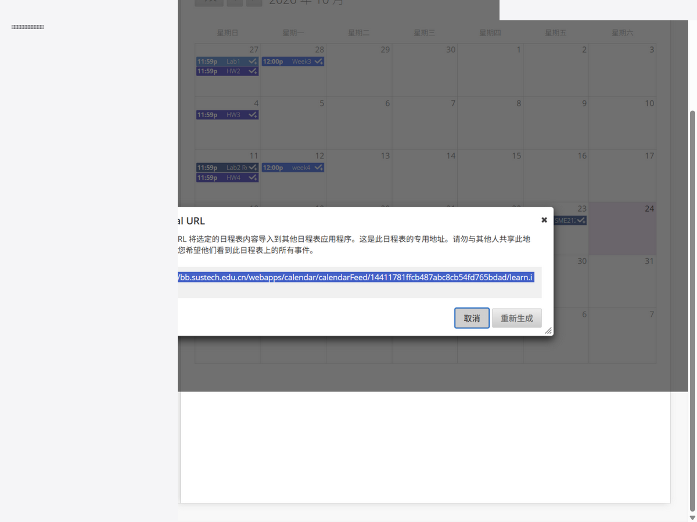
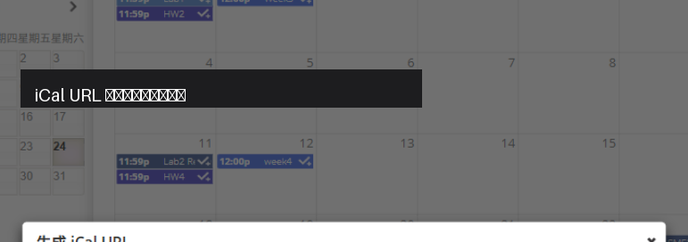
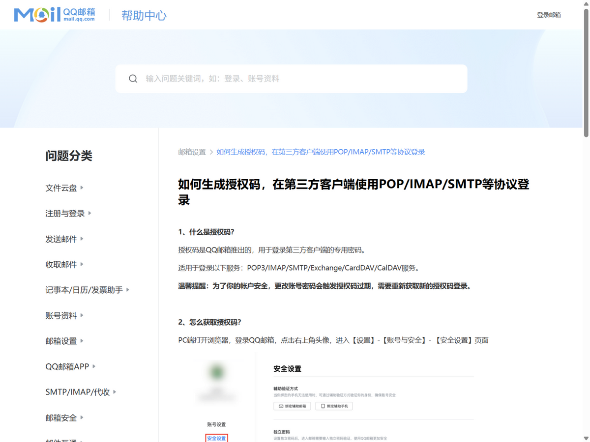
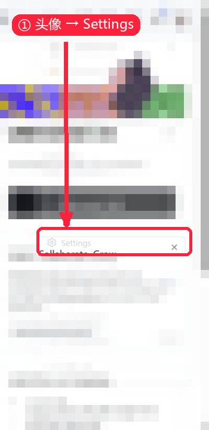
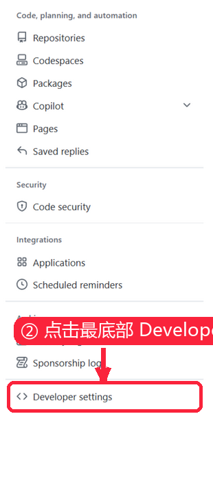
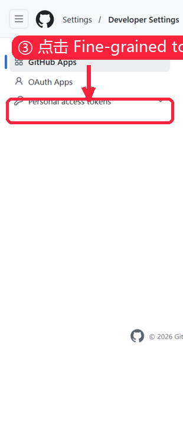
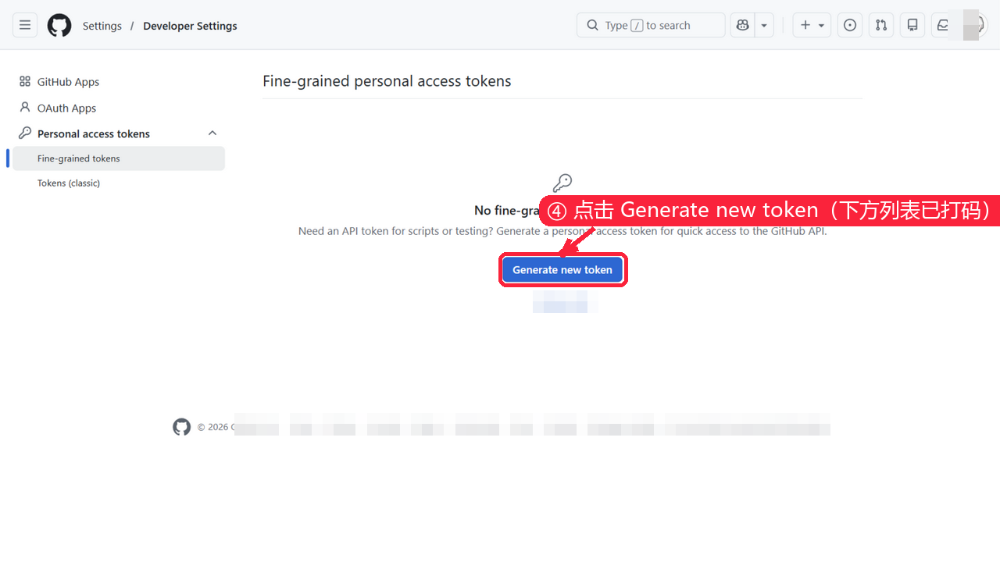
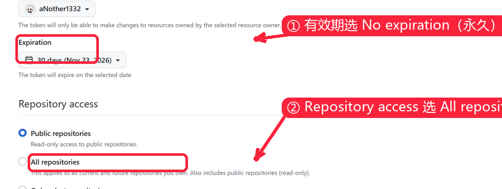
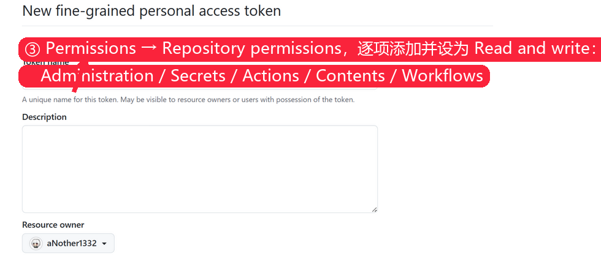

# BB Deadline Notifier

南方科技大学 Blackboard（bb.sustech.edu.cn）**作业截止日期邮件提醒工具**。纯云端运行：部署完成后你的电脑不需要安装任何东西、没有任何后台进程，提醒由 GitHub Actions 定时发出。

> **致谢**：本项目基于开源项目 [sustech-cli](https://github.com/wormforce/sustech-cli) 构建——登录模式读取成绩册的
> 数据通道完全来自该项目。遵循其 [PolyForm Noncommercial 1.0.0](https://polyformproject.org/licenses/noncommercial/1.0.0/) 许可，请勿用于商业用途。

## 这是什么

Blackboard 的截止日期藏在每门课的深处，首页看不到，容易忘。这个工具每天给你发一封"未来 14 天未交作业"日报，并在作业剩余时间跨进 **48 / 24 / 12 小时**窗口时逐级催交——发到你的邮箱（腾讯企业邮有手机推送，等于即时提醒）。

```
┌─ 提醒层（GitHub Actions，每日 4 次定时）─────────────────┐
│  登录模式：sustech-cli 读成绩册 → 课程名+提交分流 → 邮件  │
│  基础模式：直接读 BB 公开日历 ICS → 邮件（带[降级]前缀）  │
│  （登录层故障时自动降级到 ICS，提醒永不断电）             │
└──────────────────────────────────────────────────────────┘
```

| 能力 | 基础模式（无需登录） | 登录模式（填学号+密码） |
|---|---|---|
| 工作原理 | 订阅 BB 公开日历链接，零学校凭据 | 云端用你的凭据读成绩册，密码只在你仓库的加密 Secrets |
| 课程名 | ✗ | ✓（如「SME105 电路分析基础」） |
| 已提交分流 | ✗ 全部提醒 | 日报隐藏已交；分档提醒标注「已提交·请复核」 |
| 出分提醒 | ✗ | ✓（可选） |

## 快速开始（推荐：一键向导）

打开 **[一键部署向导](https://another1332.github.io/bb-deadline-notifier-template/setup.html)**，全程约 10 分钟：

1. 准备四样材料：GitHub 账号、QQ 邮箱 SMTP 授权码、BB 日历链接、GitHub 令牌（有效期建议选永久，便于以后改配置）——向导页每一步都配了**截图指引**（含官方链接，隐私内容已打码）；
2. 填表：收发件邮箱、ICS 链接；可选开启登录模式（学号+密码）；
3. 自选提醒时间（默认日报 08:00、分档检查 08:10 / 14:00 / 20:00，北京时间）；
4. 点「部署」——向导会在你的账号下从本模板生成**私有仓库**、写入加密 Secrets、配置时间表并触发首跑；
5. 几分钟内收到第一封邮件；然后去[撤销令牌](https://github.com/settings/personal-access-tokens)即可。

向导是纯静态页：**不存储任何用户数据**，你填写的信息只从浏览器加密直达 GitHub 官方 API。

### 操作截图

**BB 日历链接在哪里拿**（日历页面左下角「获取外部日程表链接」→ 弹窗里的 iCal URL，示例已打码）：




**QQ 邮箱授权码怎么生成**（官方帮助截图）：



**PAT 怎么建**（完整路径六步，个人内容已打码）：








## 手动安装（不想用向导）

1. 点击本页面绿色按钮 **"Use this template" → "Create a new repository"**，建一个 **Private** 仓库。
2. 仓库 Settings → Secrets and variables → Actions → Secrets，逐个添加：

   | Secret | 值 |
   |---|---|
   | `ICS_URL` | BB → 日历 → 获取外部日程表链接（`webcal://` 改 `https://`） |
   | `SMTP_USER` / `SMTP_PASS` | 个人 QQ 邮箱地址 / SMTP 授权码 |
   | `MAIL_TO` | 收件邮箱（建议学校企业邮，有手机推送） |
   | `SCHOOL_PASSWORD` | 学校统一认证密码（**选填**；不填 = 基础模式，填 = 登录模式） |

3. 若填了 `SCHOOL_PASSWORD`，在同一页 **Variables** 加 `SUSTECH_SID` = 你的学号。
4. Actions 页面若提示 workflows 被禁用，点 "I understand my workflows, go ahead and enable them"。
5. Actions → notify → Run workflow → mode 选 `escalate`，首次运行验证。

## 日常使用与维护

- **邮件节奏**：日报每天最多一封（全部交清则静默，静默 = 正常）；分档提醒每档每项作业只发一封，老师顺延 deadline 会重新触发。
- **改提醒时间**：在向导页重新填一遍提交即可；手动改则编辑 `.github/workflows/notify.yml` 中带 `SCHEDULE_*` 标记的 cron（UTC = 北京时间减 8 小时）。
- **改收件邮箱 / 换密码**：仓库 Settings → Secrets 里直接编辑对应项。
- **额度**：私有仓库免费 2,000 Actions 分钟/月，本工具约用 120 分钟。
- **改学校密码后**：记得同步更新 `SCHOOL_PASSWORD` secret，否则会一直收到 `[降级]` 邮件。

## 故障排查

| 现象 | 处置 |
|---|---|
| 邮件持续带 `[降级]` 前缀 | 看 Actions 日志 `[full-mode]` 行的具体原因；登录失败会在 12 小时后自动重试 |
| 登录触发滑块验证码 | 本项目不做自动绕过。等自动重试；持续出现可暂时移除 `SCHOOL_PASSWORD` 走基础模式 |
| 完全收不到邮件 | 先看 Actions 页面运行是否失败（GitHub 会发失败通知邮件）；再检查 Secrets 是否填对 |
| 日报没来但应该有 | 若所有作业都已提交，日报静默是正确行为 |

## 零安装替代方案

把 ICS 链接直接订阅进手机日历（iPhone：设置 → 日历 → 添加订阅日历），零维护；
代价是没有邮件汇总和提交分流，同步略有延迟。向导页底部也有此说明。

## 安全与隐私

- 仓库必须保持 **Private**：`state/` 含加密的会话缓存，Secrets 含你的凭据。
- 向导页纯静态、无后端、不存数据；敏感值浏览器内加密（libsodium sealed box）直达 GitHub API。
- ICS 链接等同私人令牌，不要发给任何人。
- 基于 [sustech-cli](https://github.com/wormforce/sustech-cli)（PolyForm 非商业许可，请勿用于收费服务）。
- 本项目不做、也不接受任何验证码自动绕过。
